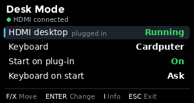
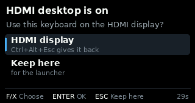
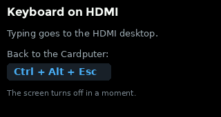

<p align="center"></p>

<h1 align="center">Desk Mode for CardputerZero</h1>

**Plug in an HDMI display and get the Raspberry Pi desktop on it, typed on with the CardputerZero's own keyboard.**

[中文说明](README.zh-CN.md)

The CardputerZero (Raspberry Pi CM0) can drive an HDMI display, but out of the box the built-in keyboard does not work on the HDMI desktop, and starting the desktop through LightDM can freeze the launcher. **Desk Mode** (`cz-desk-mode`) makes the HDMI port a desk setup: the desktop starts when you plug in, the built-in keyboard can be handed over to it, and nothing runs while HDMI is unplugged.

<p>



</p>

## What it does

- **HDMI desktop on plug-in.** Plugging in HDMI starts the Pi desktop (labwc) on it; you can turn that off and start it from the app instead. It runs as your user, without LightDM and without root.
- **Asks where the keyboard goes.** Each time HDMI is plugged in, the built-in screen asks whether the keyboard should go to the HDMI display. The screen lights up for the question even if it was off. `F`/`X` choose, `Enter` confirms, `Esc` keeps it on the Cardputer; with no answer in 30 s it stays on the Cardputer. You can also set it to always hand over or never ask.
- **Built-in keyboard on the HDMI desktop.** Symbols typed with `Sym` come out right on the desktop (the keyboard sends non-standard codes for them, which Desk Mode translates). While the keyboard is on the HDMI display, the built-in screen turns off to save power and the launcher is paused.
- **Getting the keyboard back.** `Ctrl+Alt+Esc`, unplugging HDMI, closing the desktop or the app's **Keyboard** row give it back. The built-in screen then turns on and shows the launcher.
- **Unplugging HDMI** wakes the built-in screen if it was off.
- **Closing the desktop** frees about 55 MB of RAM and ~20 mA. Do it from the app, or install [Battery Saver](https://github.com/InstantComet/cz-battery-saver), which by default closes it 1 min after HDMI is unplugged.

## Desk Mode app

| Row | What it does |
|---|---|
| **HDMI desktop** | Shows whether it is running. `Enter` starts it, or closes it after a confirmation (unsaved work in the desktop is lost). |
| **Keyboard** | `Cardputer` or `HDMI display`: move the keyboard now. |
| **Start on plug-in** | Start the desktop when HDMI is plugged in. |
| **Keyboard on start** | `Ask`, `HDMI display` (hand over without asking) or `Cardputer` (never ask). |

Keys: `F`/`X` move, `Enter` change, `I` info, `Esc` back to the launcher.

## How it works

- **Desktop:** `labwc-pi` started as a transient user unit (`cz-desk-mode-desktop.service`) with `LIBSEAT_BACKEND=noop`, on `/dev/dri/card0` (the HDMI output) only. The user `pi` may open the GPU (`video` group) and input devices (`input` group), so no seat manager or root is needed. LightDM is not used: when its autologin fails it starts its login screen, whose own PipeWire takes the sound card from the launcher and deadlocks the launcher's audio, freezing its UI.
- **Keyboard:** the built-in keyboard (`tca8418c`) is on its own seat in the stock image, so the desktop never sees it. For a handover the service grabs it (`EVIOCGRAB`) and replays the keys through a virtual keyboard (`/dev/uinput`) on the default seat, translating the `Sym` layer's codes to standard key + Shift.
- **Built-in screen:** for the question and the notice, the service pauses the launcher (and an app open in it), draws on `/dev/fb_lcd` and puts the launcher's frame back afterwards. To wake the screen it taps Shift on the built-in keyboard, so the launcher (and Battery Saver) wake as on any key press.
- **HDMI:** read from `/sys/class/drm/card0-HDMI-A-1/status` every second, woken early by the kernel's drm uevents.

## Install

**From the AppStore:** open **Store** on the CardputerZero and install **Desk Mode** (share code `DESK`).

**From source**, on the CardputerZero:

```sh
git clone https://github.com/InstantComet/cz-desk-mode.git
cd cz-desk-mode
sudo bash install.sh
```

The package installs:
- `/usr/lib/cz-desk-mode/cz-desk-mode.py`, the service
- `/usr/lib/systemd/system/cz-desk-mode.service` (enabled and started; `User=pi`)
- `/usr/lib/udev/rules.d/70-cz-desk-mode.rules`: lets the `input` group use `/dev/uinput`. That group can already read every keyboard; with this it can also create a virtual one (type).
- `/etc/default/cz-desk-mode` (default settings)
- The Desk Mode app in `/usr/share/APPLaunch/`

Logs: `journalctl -u cz-desk-mode -f`. Uninstall: `sudo apt remove cz-desk-mode`.

## Settings

The app saves its choices in `/var/lib/cz-desk-mode/settings`, which overrides `/etc/default/cz-desk-mode`.

| Variable | Default | Meaning |
|---|---|---|
| `AUTOSTART` | `1` | Start the desktop when HDMI is plugged in. |
| `KEYBOARD_ON_START` | `ask` | `ask`, `desktop` or `cardputer`: where the keyboard goes when HDMI is plugged in and the desktop is up. |

## Notes

- Tested on a CardputerZero running Debian 13 (trixie), kernel `6.18.39+rpt-rpi-v8`, the stock launcher and the stock `labwc-pi` desktop. The user is assumed to be `pi` (uid 1000).
- If LightDM is enabled on your image, disable it (`sudo systemctl disable lightdm`) so it doesn't start a second desktop at boot.
- The desktop has no login session, so the panel's update checker would ask for a password (PackageKit via polkit) every time the desktop starts. The first time Desk Mode starts the desktop, it takes `updater` off the panel's widget list in `~/.config/wf-panel-pi/wf-panel-pi.ini` (once only: add it back in the panel's settings and it stays). Update with `sudo apt update && sudo apt full-upgrade` instead.
- If HDMI bounces as it is plugged in, Desk Mode waits for it to settle and tries starting the desktop up to 3 times.

## License

MIT
