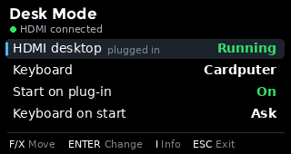
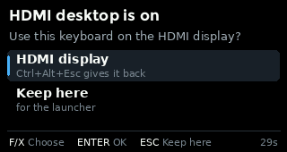
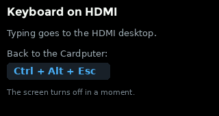

<p align="center"></p>

<h1 align="center">Desk Mode（桌面模式）</h1>

**插上 HDMI 显示器就有树莓派桌面，用 CardputerZero 自带的键盘打字。**

[English](README.md)

CardputerZero（树莓派 CM0）可以接 HDMI 显示器，但默认情况下机身键盘在 HDMI 桌面上用不了，而且用 LightDM 启动桌面可能会让启动器卡死。**Desk Mode**（`cz-desk-mode`）把 HDMI 口变成桌面用法：插上就启动桌面，机身键盘可以交给桌面使用，拔掉 HDMI 时什么都不运行。

<p>



</p>

## 功能

- **插上 HDMI 自动启动桌面**（labwc），也可以关掉自动启动，改在应用里手动启动。以当前用户身份运行，不用 LightDM，也不需要 root。
- **询问键盘给谁。** 每次插上 HDMI，内置屏都会询问键盘要不要交给 HDMI 显示器；即使内置屏原本熄着，也会先亮屏再询问。`F`/`X` 选择，`Enter` 确认，`Esc` 留在 Cardputer；30 秒不回答就留在 Cardputer。也可以设为总是交给桌面或从不询问。
- **机身键盘用在 HDMI 桌面上。** 用 `Sym` 打的符号在桌面上也正确（键盘对这些符号发的是非标准键码，Desk Mode 会转换）。键盘交出去时，内置屏熄灭省电，启动器暂停。
- **拿回键盘：** 按 `Ctrl+Alt+Esc`、拔掉 HDMI、关闭桌面，或者在应用的 **Keyboard** 一行切换。之后内置屏亮起，回到启动器。
- **拔掉 HDMI** 时，如果内置屏是熄的，会把它唤醒。
- **关闭桌面**可以省下约 55 MB 内存和约 20 mA 电流。可以在应用里关；装了 [Battery Saver](https://github.com/InstantComet/cz-battery-saver) 的话，它默认会在拔掉 HDMI 1 分钟后自动关。

## Desk Mode 应用

| 行 | 作用 |
|---|---|
| **HDMI desktop** | 显示桌面是否在运行。按 `Enter` 启动；关闭前会先确认（桌面里没保存的东西会丢）。 |
| **Keyboard** | `Cardputer` 或 `HDMI display`：立即切换键盘。 |
| **Start on plug-in** | 插上 HDMI 时自动启动桌面。 |
| **Keyboard on start** | `Ask`（询问）、`HDMI display`（不问，直接交给桌面）或 `Cardputer`（从不询问）。 |

按键：`F`/`X` 移动，`Enter` 修改，`I` 说明，`Esc` 返回启动器。

## 原理

- **桌面：** 以用户临时单元（`cz-desk-mode-desktop.service`）运行 `labwc-pi`，设置 `LIBSEAT_BACKEND=noop`，只使用 `/dev/dri/card0`（HDMI 输出）。用户 `pi` 在 `video` 组和 `input` 组里，可以打开 GPU 和输入设备，所以不需要 seat 管理器，也不需要 root。不用 LightDM 的原因：它自动登录失败时会启动登录界面，登录界面自带的 PipeWire 会抢走启动器的声卡，导致启动器的音频死锁、界面卡住。
- **键盘：** 原版系统把机身键盘（`tca8418c`）分到了单独的 seat，桌面看不到它。移交时，服务独占它（`EVIOCGRAB`），通过默认 seat 上的虚拟键盘（`/dev/uinput`）转发按键，并把 `Sym` 层的键码转换成标准键加 Shift。
- **内置屏：** 显示询问和提示时，服务暂停启动器（以及启动器里打开的应用），在 `/dev/fb_lcd` 上绘制，结束后恢复启动器原来的画面。唤醒屏幕时在机身键盘上模拟按一下 Shift，让启动器（以及 Battery Saver）像平时按键一样醒来。
- **HDMI：** 每秒读一次 `/sys/class/drm/card0-HDMI-A-1/status`，内核的 drm uevent 让它更早醒来。

## 安装

**从应用商店：** 在 CardputerZero 上打开 **Store**，安装 **Desk Mode**（分享码 `DESK`）。

**从源码安装**，在 CardputerZero 上运行：

```sh
git clone https://github.com/InstantComet/cz-desk-mode.git
cd cz-desk-mode
sudo bash install.sh
```

安装的文件：
- `/usr/lib/cz-desk-mode/cz-desk-mode.py`：服务本体
- `/usr/lib/systemd/system/cz-desk-mode.service`（已启用并启动；`User=pi`）
- `/usr/lib/udev/rules.d/70-cz-desk-mode.rules`：允许 `input` 组使用 `/dev/uinput`。这个组本来就能读所有键盘；加上这条规则后，它还能创建虚拟键盘（也就是能模拟打字）。
- `/etc/default/cz-desk-mode`（默认设置）
- `/usr/share/APPLaunch/` 下的 Desk Mode 应用

日志：`journalctl -u cz-desk-mode -f`。卸载：`sudo apt remove cz-desk-mode`。

## 设置

应用把你的选择存在 `/var/lib/cz-desk-mode/settings`，优先于 `/etc/default/cz-desk-mode`。

| 变量 | 默认值 | 含义 |
|---|---|---|
| `AUTOSTART` | `1` | 插上 HDMI 时自动启动桌面。 |
| `KEYBOARD_ON_START` | `ask` | `ask`、`desktop` 或 `cardputer`：插上 HDMI 且桌面运行时，键盘交给谁。 |

## 说明

- 在 Debian 13（trixie）、内核 `6.18.39+rpt-rpi-v8`、原版启动器和原版 `labwc-pi` 桌面的 CardputerZero 上测试过。默认用户为 `pi`（uid 1000）。
- 如果你的系统启用了 LightDM，请禁用它（`sudo systemctl disable lightdm`），以免开机时多启动一个桌面。
- 这个桌面没有登录会话，面板的更新检查每次桌面启动都会弹窗要密码（PackageKit 通过 polkit 发起）。所以 Desk Mode 第一次启动桌面时，会从 `~/.config/wf-panel-pi/wf-panel-pi.ini` 的面板组件列表里去掉 `updater`。只做这一次：你在面板设置里加回来，它不会再去掉。更新系统请用 `sudo apt update && sudo apt full-upgrade`。
- 插上 HDMI 时如果接口断开又连上，Desk Mode 会等它稳定后再启动桌面，最多尝试 3 次。

## 许可

MIT
